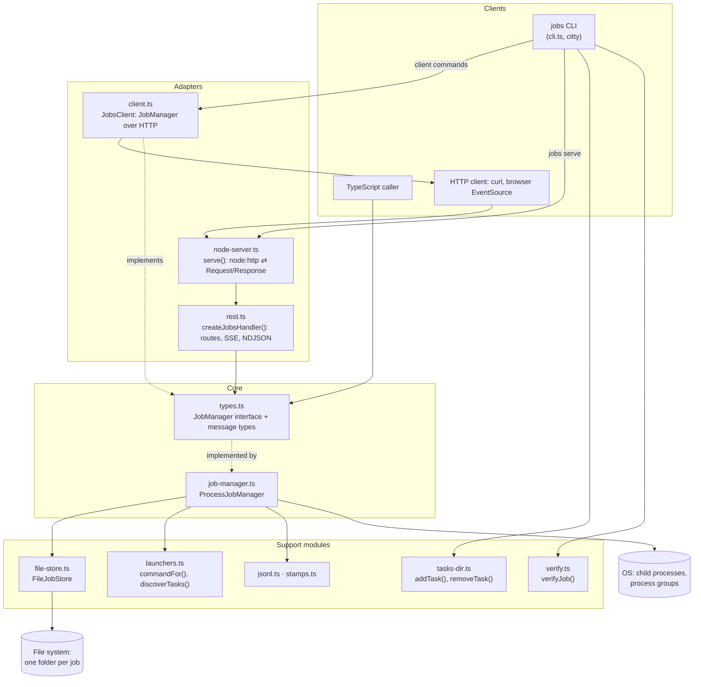
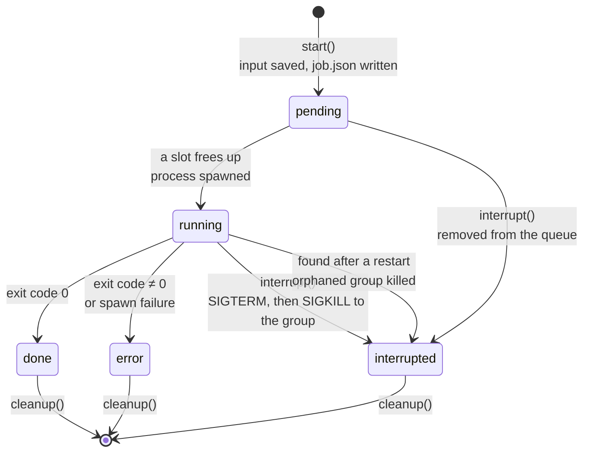
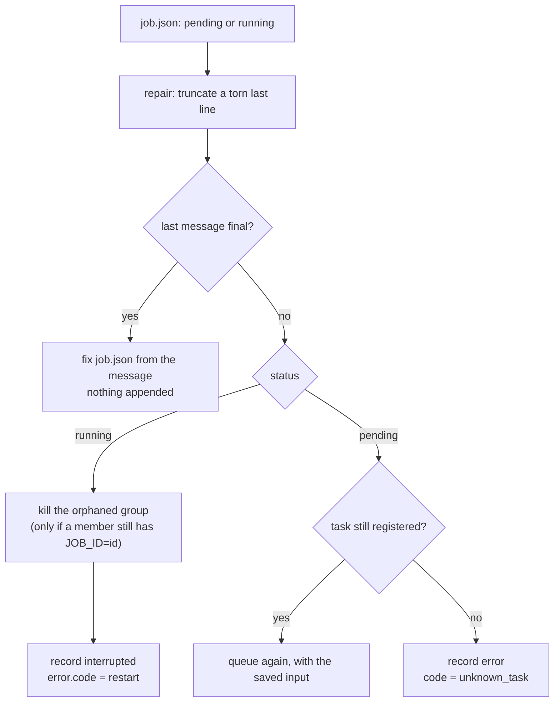

# Architecture

How the jobs manager is put together today, and why. The prototype has about 2,000 lines in
`src/`. Its one runtime dependency is citty, used by the CLI.

## 1. Layers



| Module | Lines | Responsibility |
| --- | ---: | --- |
| `types.ts` | 115 | The contract: `JobManager`, `JobMessage`, `JobInfo`, `TaskDefinition`, `JobsError`. Nothing in it depends on Node. |
| `job-manager.ts` | 502 | `ProcessJobManager`: the queue, spawning, recording, following, interrupting, recovery and cleanup. `setTasks()` swaps the registered tasks. |
| `file-store.ts` | 140 | `FileJobStore`: the folder layout, atomic `job.json`, ordered appends, repair of torn lines. |
| `launchers.ts` | 57 | Extension → command table; finds tasks in a folder (`name.ext` + `name.cleanup.ext`). |
| `tasks-dir.ts` | 57 | Adds and removes tasks in that folder layout (used by `jobs tasks add` and `jobs tasks remove`). |
| `rest.ts` | 243 | Fetch-style handler over *any* `JobManager`: routes, request parsing, SSE and NDJSON streaming, error mapping. |
| `node-server.ts` | 67 | Bridges `node:http` to `Request`/`Response`, with request and response bodies streamed. |
| `client.ts` | 142 | `JobsClient`: the `JobManager` interface over the REST API. Server error codes come back as `JobsError`. |
| `verify.ts` | 80 | `verifyJob()`: checks a job's status and results against expectations. Patterns match subsets. |
| `cli.ts` | 549 | The `jobs` CLI (citty): `serve` and the client commands; see the README. |
| `jsonl.ts`, `stamps.ts` | 37 | Splits a byte stream into lines (a JSON line becomes a value); timestamps that strictly increase within a job. |

**Build:** tsdown (rolldown) bundles `dist/index.mjs`, `dist/cli.mjs` and type declarations.
Vitest builds `dist/` in a global setup and tests the bundle as well as the source. Turbo orders
`build` before `test`.

**The main boundary is the `JobManager` interface.** The REST layer only knows that interface,
so a different implementation can sit behind the same HTTP API, for example one running jobs in
Durable Objects. `JobsClient` implements the interface on the other side of HTTP. The CLI, or any
caller, works the same against a local manager or a remote server. `FileJobStore`, on the other hand, is a concrete class. Swapping in
another store (SQLite, S3) means extracting an interface from it first. That isn't done yet.

## 2. Job lifecycle



Every transition is recorded as a message, and while the job runs, so is every output line:

| Message | Recorded when |
| --- | --- |
| `{ status: "pending" }` | the job is accepted |
| `{ status: "running" }` | the process has been spawned |
| `{ status: "running", message }` | the script writes a stdout line |
| `{ status: "running", error }` | the script writes a stderr line |
| `{ status: "done" }` | the script exits with code 0 |
| `{ status: "error", error: { code, … } }` | the script exits with another code (`exit`), can't be spawned (`spawn`), or the manager fails internally (`internal`) |
| `{ status: "interrupted", error? }` | a client interrupts the job, or recovery finds it orphaned (`error.code: "restart"`) |

`status` in a message is always the job's status at that moment. The payload field (`message` or
`error`) says where the message came from. A stderr warning therefore doesn't look like a failure.

## 3. Starting and running a job

```mermaid
sequenceDiagram
  autonumber
  participant C as Client
  participant M as ProcessJobManager
  participant S as FileJobStore
  participant P as Script process
  C->>M: start(task, params, input)
  M->>S: create(): mkdir, save input, write job.json
  M->>S: append {pending}
  M-->>C: jobId
  Note over M: queue: waits while running = maxConcurrent
  M->>P: spawn(launcher, script), own process group<br/>env JOB_ID, JOB_TASK, JOB_PARAMS, JOB_DIR
  Note over M,P: same tick: record {running}, attach the stdout and stderr readers
  M->>P: stdin ← saved input
  loop each output line
    P-->>M: stdout or stderr line
    M->>S: append {running, message|error}
    M-->>C: notify followers
  end
  P-->>M: exit(code, signal)
  M->>S: append {done|error|interrupted}, rewrite job.json
  M-->>C: final message; followers end
```

Details that matter:

- **The input is saved before the job is queued.** A job can then wait behind the concurrency
  limit, and still run after a restart, without holding a client connection open. `start()` is
  all or nothing: if the input stream fails, the job folder is removed and `start()` rejects.
- **The readers attach in the same tick as `spawn`.** When a child exits, Node discards any output
  nobody is reading (`flushStdio`). The `running` record takes its stamp synchronously, so it
  still comes before every output line. A regression test runs 20 instant jobs to check this.
- **Recording is serialised per job.** `#record()` takes the stamp synchronously, then
  `FileJobStore` chains every append and `job.json` write for that job. So the file order, the
  stamp order and the order followers see are all the same.
- **Launchers** come from the extension: `.js .mjs .cjs .ts .mts` → `node`, `.py` → `python3`,
  `.sh` → `bash`, `.rb` → `ruby`, `.r`/`.R` → `Rscript`. Any other file is executed directly.
  The table can be overridden per manager.

## 4. Following logs

`logs(id, since, { follow, signal })` is an async generator:

1. It subscribes to the job's in-memory listener set, **before** reading the file.
2. It reads `messages.jsonl` and yields the messages after `since`.
3. It yields the messages that arrived meanwhile, skipping any whose stamp it has already
   yielded, then waits for more.
4. It ends after the final message, when `signal` aborts, or straight away when `follow: false`.

Subscribing before reading means nothing recorded during the read is lost, and the strictly
increasing stamps remove the duplicates. The same stamps serve as the resume point for `since`
and as the SSE event id for `Last-Event-ID`.

## 5. Concurrency and interrupt

- **The queue** is FIFO, in memory, limited by `maxConcurrent` (default 4). A finished job
  triggers `#pump()`, which starts the next one.
- **Interrupting a pending job** removes it from the queue and records `interrupted`. The script
  never runs.
- **Interrupting a running job:**
  1. SIGTERM goes to the job's **process group**. Jobs are spawned `detached`, which makes each
     script a group leader.
  2. SIGKILL goes to the group after `killGraceMs`, even if the script itself has already exited.
     A process it started may ignore SIGTERM.
  3. `interrupt()` resolves once the script has exited and `interrupted` is recorded.
- **Interrupting while the input is still being saved** sets a flag, and the job is recorded as
  `interrupted` without ever being spawned.

## 6. Storage

```
<root>/<uuid>/job.json        { id, task, params, status, created, updated, pid? }   atomic: tmp + rename
<root>/<uuid>/messages.jsonl  one JobMessage per line, appended in order              the source of truth
<root>/<uuid>/input           the saved input stream (optional)
<root>/<uuid>/work/           JOB_DIR, the script's scratch folder
```

- **`messages.jsonl` is the source of truth.** `job.json` is a cache for fast `info()` and
  `list()` calls.
- **Job ids are UUIDs**, and are checked as such before any path is built from them. A REST path
  can't escape `root`.
- **`pid`** is the process-group id, saved while the job runs, so a restarted manager can stop
  what the dead one left behind.

## 7. Crash recovery (`init()`, run by `createJobManager`)

For each job folder whose `job.json` says the job isn't finished:



A job is never restarted automatically after it was running. Its side effects may be partial,
so the client decides whether to start it again.

## 8. Cleanup

`cleanup(before = now)` takes jobs **one cleanup at a time**, so a timer tick never races an
explicit call. It only considers finished jobs whose `updated` stamp is at or before `before`, to the millisecond. For
each one:

1. If the task has a cleanup script, the script runs with the job's environment, and
   `messages.jsonl` arrives on its stdin. It can therefore delete whatever the job reported, such
   as S3 keys.
2. If the cleanup script exits non-zero, the job is **kept** and reported in `failed`, so a later
   cleanup retries it.
3. Otherwise the job folder is deleted and the id is reported in `removed`.

`retention: { maxAgeMs, intervalMs }` runs `cleanup(now - maxAgeMs)` on an unref'd timer.
`close()` stops the timer and waits for a cleanup that is in progress.

## 9. REST mapping

| Route | Calls |
| --- | --- |
| `GET /tasks` | `tasks()` |
| `POST /tasks/:task/jobs` | `start()`; the body is JSON params, multipart (`params` + `input`), or a raw input stream with `?params=` |
| `GET /jobs`, `GET /jobs/:id` | `list()`, `info()` |
| `GET /jobs/:id/logs` | `logs(id, since, { follow })` as NDJSON |
| `GET /jobs/:id/events` | `logs(id, since, { follow: true })` as SSE, with keep-alive comments |
| `DELETE /jobs/:id` | `interrupt()` |
| `POST /cleanup` | `cleanup(before)` |

When the client disconnects, the request's signal aborts the follower. `before`, `since` and
`Last-Event-ID` must be finite numbers, or the request gets 400. They are never read as
"everything".

## 10. Known limits

- **One manager per root.** There is no lock file, and a second manager on the same root would
  take the first one's pending jobs.
- **`list()` and `cleanup()` read every `job.json`.** That's fine for thousands of jobs; more
  would need an index.
- **Reruns start from scratch.** Jobs have no checkpointing.
- **No authentication, timeouts or output size limits.**
- **The store is not swappable yet.** `FileJobStore` has no interface (section 1).
