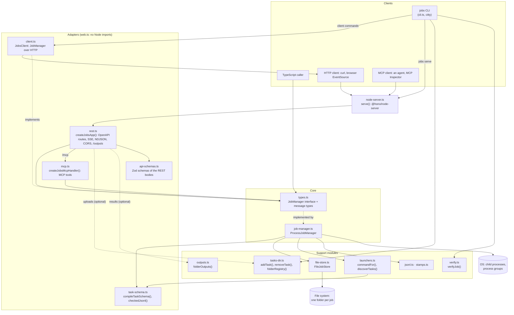
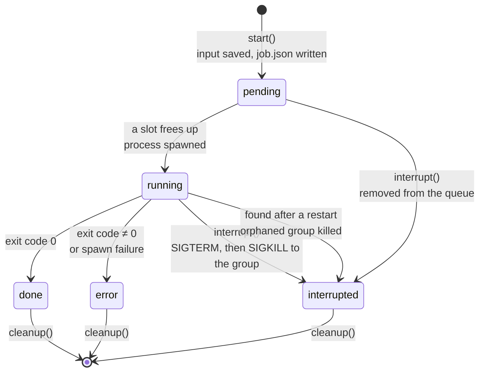
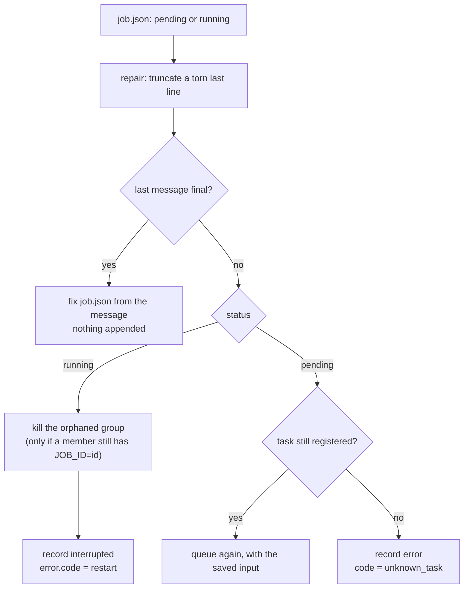

# Architecture

How the jobs manager is put together, and why. About 3,200 lines in `src/`. Runtime
dependencies: Hono and `@hono/zod-openapi` (the HTTP app and its OpenAPI document), Zod (schemas),
the MCP server SDK, `@hono/node-server` (serving on Node) and citty (the CLI).

## 1. Layers



| Module | Lines | Responsibility |
| --- | ---: | --- |
| `types.ts` | 179 | The contract: `JobManager`, `JobMessage`, `JobInfo`, `TaskDefinition`, `TaskSchema`, `Issue`, `TaskRegistry`, `OutputFiles`, `JobsError`. Nothing in it depends on Node. |
| `job-manager.ts` | 553 | `ProcessJobManager`: the queue, spawning, recording, schema checks, following, interrupting, recovery and cleanup; per-job results folders. `setTasks()` swaps the registered tasks (and refuses an invalid schema). |
| `task-schema.ts` | 127 | Compiles a `TaskSchema` into checks with `z.fromJSONSchema` (cached per distinct schema); checks a JSONL input line by line while it streams through. Node-free. |
| `file-store.ts` | 136 | `FileJobStore`: the folder layout, atomic `job.json`, ordered appends, repair of torn lines. |
| `launchers.ts` | 92 | Extension → command table; finds tasks in a folder (`name.ext`, `name.cleanup.ext`, `name.schema.json`), skipping a task whose schema does not compile. |
| `tasks-dir.ts` | 107 | Adds and removes tasks in that folder layout: from files (`jobs tasks add`/`remove`), and from uploaded source (`folderRegistry()`, a `TaskRegistry`, schema included). |
| `rest.ts` | 556 | `createJobsApp()`: an `OpenAPIHono` app over *any* `JobManager`: routes declared with `createRoute`, request validation, the OpenAPI document, SSE and NDJSON streaming, task upload, results files, CORS, error mapping; mounts MCP at `/mcp`. |
| `api-schemas.ts` | 135 | Zod schemas of the REST bodies (`JobInfo`, `JobMessage`, `TaskSchema`, `Error`, …): request validation and `components.schemas`. |
| `mcp.ts` | 292 | `createJobsMcpHandler()`: MCP tools over any `JobManager` (stateless Streamable HTTP): `job_logs` as a cursor long-poll, `follow_job` streaming progress notifications. |
| `outputs.ts` | 50 | `folderOutputs()`: `OutputFiles` over the results folders, confined to each job's own folder. |
| `web.ts`, `ids.ts` | 28 | The runtime-agnostic entry (REST app, MCP, client, types); the UUID check shared by the store and the adapters. |
| `node-server.ts` | 24 | `serve()`: a fetch handler on Node through `@hono/node-server`. |
| `client.ts` | 149 | `JobsClient`: the `JobManager` interface over the REST API. Server error codes come back as `JobsError`. |
| `verify.ts` | 80 | `verifyJob()`: checks a job's status and results against expectations. Patterns match subsets. |
| `cli.ts` | 603 | The `jobs` CLI (citty): `serve` and the client commands; see [cli.md](cli.md). |
| `jsonl.ts`, `stamps.ts` | 37 | Splits a byte stream into lines (a JSON line becomes a value); timestamps that strictly increase within a job. |

**Build:** tsdown (rolldown) bundles `dist/index.mjs`, `dist/web.mjs`, `dist/cli.mjs` and type declarations.
Vitest builds `dist/` in a global setup and tests the bundle as well as the source. Turbo orders
`build` before `test`.

**The adapters are runtime-agnostic.** Everything reachable from `web.ts` (the Hono app, the MCP
handler, `JobsClient`, the schema checks, Zod and `@hono/zod-openapi`) uses only Web-standard APIs, so it runs on Node, Bun, Deno or a Worker.
`test/agnostic.test.ts` walks that import graph and `test/dist.test.ts` scans the built
`dist/web.mjs`; both fail on a `node:` import.

**The main boundary is the `JobManager` interface.** The REST and MCP layers only know that interface,
so a different implementation can sit behind the same HTTP API, for example one running jobs in
Durable Objects. `JobsClient` implements the interface on the other side of HTTP. The CLI, or any
caller, works the same against a local manager or a remote server. `FileJobStore`, on the other hand, is a concrete class. Swapping in
another store (SQLite, S3) means extracting an interface from it first. That isn't done yet.

## 2. Job lifecycle



Every transition is recorded as a message, and while the job runs, so is every output line:

| Message | Recorded when |
| --- | --- |
| `{ status: "pending" }` | the job is accepted |
| `{ status: "running" }` | the process has been spawned |
| `{ status: "running", message }` | the script writes a stdout line |
| `{ status: "running", error }` | the script writes a stderr line |
| `{ status: "running", error: { code: "invalid_message" \| "invalid_error", issues, raw } }` | a stdout / stderr line its task's schema rejects |
| `{ status: "done" }` | the script exits with code 0 |
| `{ status: "error", error: { code, … } }` | the script exits with another code (`exit`), can't be spawned (`spawn`), or the manager fails internally (`internal`) |
| `{ status: "interrupted", error? }` | a client interrupts the job, or recovery finds it orphaned (`error.code: "restart"`) |

`status` in a message is always the job's status at that moment. The payload field (`message` or
`error`) says where the message came from. A stderr warning therefore doesn't look like a failure.

## 3. Starting and running a job

```mermaid
sequenceDiagram
  autonumber
  participant C as Client
  participant M as ProcessJobManager
  participant S as FileJobStore
  participant P as Script process
  C->>M: start(task, params, input)
  Note over M: params checked against the task's schema<br/>(a mismatch rejects: nothing created)
  M->>S: create(): mkdir, save input (JSONL lines checked as they pass), write job.json
  M->>S: append {pending}
  M-->>C: jobId
  Note over M: queue: waits while running = maxConcurrent
  M->>P: spawn(launcher, script), own process group<br/>env JOB_ID, JOB_TASK, JOB_PARAMS, JOB_DIR (+ JOB_OUTPUT_DIR/URL)
  Note over M,P: same tick: record {running}, attach the stdout and stderr readers
  M->>P: stdin ← saved input
  loop each output line
    P-->>M: stdout or stderr line
    Note over M: checked against the message / error schema
    M->>S: append {running, message|error}
    M-->>C: notify followers
  end
  P-->>M: exit(code, signal)
  M->>S: append {done|error|interrupted}, rewrite job.json
  M-->>C: final message; followers end
```

Details that matter:

- **The input is saved before the job is queued.** A job can then wait behind the concurrency
  limit, and still run after a restart, without holding a client connection open. `start()` is
  all or nothing: if the input stream fails, the job folder is removed and `start()` rejects.
- **The readers attach in the same tick as `spawn`.** When a child exits, Node discards any output
  nobody is reading (`flushStdio`). The `running` record takes its stamp synchronously, so it
  still comes before every output line. A regression test runs 20 instant jobs to check this.
- **Recording is serialised per job.** `#record()` takes the stamp synchronously, then
  `FileJobStore` chains every append and `job.json` write for that job. So the file order, the
  stamp order and the order followers see are all the same.
- **Schema checks sit at three points** (section 4a): `start()` checks params before creating
  anything; `checkedJsonl()` wraps the input iterator, so a bad JSONL line fails the store's write
  and with it `start()`; `#run()` checks each output line before recording it.
- **Launchers** come from the extension: `.js .mjs .cjs .ts .mts` → `node`, `.py` → `python3`,
  `.sh` → `bash`, `.rb` → `ruby`, `.r`/`.R` → `Rscript`. Any other file is executed directly.
  The table can be overridden per manager.

## 4. Following logs

`logs(id, since, { follow, signal })` is an async generator:

1. It subscribes to the job's in-memory listener set, **before** reading the file.
2. It reads `messages.jsonl` and yields the messages after `since`.
3. It yields the messages that arrived meanwhile, skipping any whose stamp it has already
   yielded, then waits for more.
4. It ends after the final message, when `signal` aborts, or straight away when `follow: false`.

Subscribing before reading means nothing recorded during the read is lost, and the strictly
increasing stamps remove the duplicates. The same stamps serve as the resume point for `since`
and as the SSE event id for `Last-Event-ID`.

## 4a. Task schemas

A `TaskDefinition` may carry a `TaskSchema` (`{ params?, body?, message?, error? }`, each a JSON
Schema), read by `discoverTasks` from `<name>.schema.json`. `compileTaskSchema()` turns it into
checks with `z.fromJSONSchema`, once per distinct schema text (a cache keyed by the JSON), because
`jobs serve` re-scans the tasks folder on every request.

| Part | Where | Effect of a mismatch |
| --- | --- | --- |
| `params` | `start()`, before an id exists | `JobsError("invalid_params", …, issues)`; nothing created |
| `body` (JSON Schema) | `checkedJsonl()` around the input, while `FileJobStore.create()` writes it | the write fails, `start()` removes the half-made job and rethrows |
| `body` (`contentMediaType`, no `type`) | — | none: opaque bytes |
| `message`, `error` | `#run()`, per line | the line is recorded as `{ code: "invalid_message" \| "invalid_error", issues, raw }` |

Checks use `safeParse` and keep the original value, so a `default` in a schema never changes what
the script or the client sees. `format: "uri-reference"` (and `iri-reference`, `uri-template`) is
removed before compiling, because Zod would check it as an absolute URL. `setTasks()` compiles every
schema before swapping, so a bad definition built in code throws without replacing the tasks;
`discoverTasks` instead skips the task and reports it through `onSkip`.

Why output mismatches are recorded rather than fatal: the job's outcome stays its exit code, a long
job is not killed over one bad line, and the line itself is kept in `raw`.

## 5. Concurrency and interrupt

- **The queue** is FIFO, in memory, limited by `maxConcurrent` (default 4). A finished job
  triggers `#pump()`, which starts the next one.
- **Interrupting a pending job** removes it from the queue and records `interrupted`. The script
  never runs.
- **Interrupting a running job:**
  1. SIGTERM goes to the job's **process group**. Jobs are spawned `detached`, which makes each
     script a group leader.
  2. SIGKILL goes to the group after `killGraceMs`, even if the script itself has already exited.
     A process it started may ignore SIGTERM.
  3. `interrupt()` resolves once the script has exited and `interrupted` is recorded.
- **Interrupting while the input is still being saved** sets a flag, and the job is recorded as
  `interrupted` without ever being spawned.

## 6. Storage

```
<root>/<uuid>/job.json        { id, task, params, status, created, updated, pid? }   atomic: tmp + rename
<root>/<uuid>/messages.jsonl  one JobMessage per line, appended in order              the source of truth
<root>/<uuid>/input           the saved input stream (optional)
<root>/<uuid>/work/           JOB_DIR, the script's scratch folder
```

- **`messages.jsonl` is the source of truth.** `job.json` is a cache for fast `info()` and
  `list()` calls.
- **Job ids are UUIDs**, and are checked as such before any path is built from them. A REST path
  can't escape `root`.
- **`pid`** is the process-group id, saved while the job runs, so a restarted manager can stop
  what the dead one left behind.
- **Results folders** (`outputs: { dir, url }`) live outside `root`: `<dir>/<id>/`, created in
  `#run()` just before the spawn and passed as `JOB_OUTPUT_DIR`, with `JOB_OUTPUT_URL =
  <url>/<id>/`. The manager deletes no file in them (the task's cleanup script does); at cleanup it
  removes the folder only if the job left it empty. The REST app serves
  them through an `OutputFiles` (`folderOutputs()` on Node: `realpath` both the folder and the
  file, serve only regular files strictly inside the folder).

## 7. Crash recovery (`init()`, run by `createJobManager`)

For each job folder whose `job.json` says the job isn't finished:



A job is never restarted automatically after it was running. Its side effects may be partial,
so the client decides whether to start it again.

## 8. Cleanup

`cleanup(before = now)` takes jobs **one cleanup at a time**, so a timer tick never races an
explicit call. It only considers finished jobs whose `updated` stamp is at or before `before`, to the millisecond. For
each one:

1. If the task has a cleanup script, the script runs with the job's environment, and
   `messages.jsonl` arrives on its stdin. It can therefore delete whatever the job reported, such
   as S3 keys.
2. If the cleanup script exits non-zero, the job is **kept** and reported in `failed`, so a later
   cleanup retries it.
3. Otherwise the job folder is deleted and the id is reported in `removed`.

`retention: { maxAgeMs, intervalMs }` runs `cleanup(now - maxAgeMs)` on an unref'd timer.
`close()` stops the timer and waits for a cleanup that is in progress.

## 9. REST mapping

| Route | Calls |
| --- | --- |
| `GET /openapi.json` | the document generated from the routes' Zod schemas (`app.doc31`) |
| `GET /tasks` | `tasks()` |
| `POST /tasks/:task/jobs` | `start()`; the body is JSON params, multipart (`params` + `input`), or a raw input stream with `?params=` |
| `GET /jobs`, `GET /jobs/:id` | `list()`, `info()` |
| `GET /jobs/:id/logs` | `logs(id, since, { follow })` as NDJSON |
| `GET /jobs/:id/events` | `logs(id, since, { follow: true })` as SSE, with keep-alive comments |
| `DELETE /jobs/:id` | `interrupt()` |
| `POST /cleanup` | `cleanup(before)` |
| `PUT`, `DELETE /tasks/:name` | `registry.add()`, `registry.remove()`; 403 without a registry |
| `GET /outputs/:id/*` | `outputs.read(id, path)`; 404 for anything it does not return |
| `* /mcp` | the MCP handler (below) |

**Validation.** Routes are declared with `createRoute` and the schemas in `api-schemas.ts`; the
adapter validates path, query and JSON bodies, and its `defaultHook` turns a failure into
`JobsError("invalid_params", …, issues)`, so errors keep one shape. Two routes are validated by
hand while still documented: `POST /tasks/:task/jobs`, whose body must reach the handler unread
(JSON, multipart or a raw stream; it is documented with plain JSON Schemas, which the adapter does
not enforce), and `PUT /tasks/:name`, which checks the registry first (403 whatever the body) and
accepts a JSON body under any content type. `/outputs/*` and `/mcp` are added to the document with
`registerPath`: a path of any depth cannot be a route parameter, and MCP is JSON-RPC.

When the client disconnects, the request's signal aborts the follower. `before`, `since` and
`Last-Event-ID` must be finite numbers, or the request gets 400. They are never read as
"everything".

## 10. MCP mapping

`createJobsMcpHandler(manager, { registry })` wraps the SDK's `createMcpHandler`, which builds a
fresh `McpServer` per request: no MCP sessions, so nothing to expire or share between processes.

| Tool | Calls |
| --- | --- |
| `list_tasks` | `tasks()` |
| `start_job` | `start(task, params, [bytes])`; `input` is UTF-8 encoded, `inputBase64` decoded with `atob` |
| `get_job`, `list_jobs` | `info()`, `list()` |
| `job_logs` | `logs(id, since, { follow: false })`; if that is empty and `waitMs > 0`, `logs(…, { follow: true, signal: AbortSignal.timeout(waitMs) })` until the first message, then one more snapshot read for whatever arrived with it |
| `follow_job` | `logs(id, since, { follow: true, signal })` with `signal` = `timeoutMs` or the request's abort; each message sent as `notifications/progress` when the call has a `progressToken`; at most `MAX_PAGE` messages |
| `interrupt_job`, `cleanup_jobs` | `interrupt()`, `cleanup(before)` |
| `add_task`, `remove_task` | `registry.add()`, `registry.remove()`; registered only when a registry is given |

`job_logs` and `follow_job` return `next` (the last stamp, or `since` when nothing came) and
`finished`, true once the final message has been returned: in the page, or before the cursor
(`next >= info.updated` for a finished job, since `updated` is the final message's stamp). The
job's status alone is not enough: it turns terminal before the final message is readable.

A cancelled `follow_job` keeps running until the HTTP request closes or `timeoutMs` passes: the
client's `notifications/cancelled` arrives as a separate request at a fresh, stateless server that
knows nothing of the call. The SDK aborts `mcpReq.signal` when the request closes. A `JobsError` becomes a tool error whose text starts with its
code.

## 11. Known limits

- **One manager per root.** There is no lock file, and a second manager on the same root would
  take the first one's pending jobs.
- **`list()` and `cleanup()` read every `job.json`.** That's fine for thousands of jobs; more
  would need an index.
- **Reruns start from scratch.** Jobs have no checkpointing.
- **No authentication, timeouts or output size limits.** No Host or Origin check either, so a
  server on `localhost` takes simple requests from any web page (CORS only hides the responses).
- **The store is not swappable yet.** `FileJobStore` has no interface (section 1).
- **MCP cancellation needs a disconnect** (section 10).
- **A JSONL input is checked while it is stored**, so a huge input with a bad last line is read
  to that line before it is refused.
